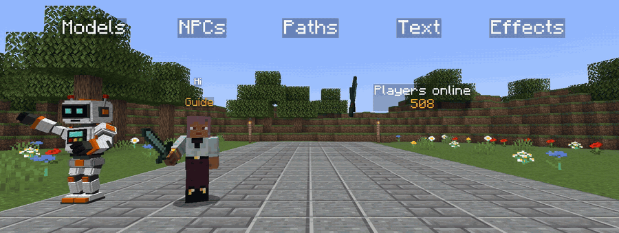
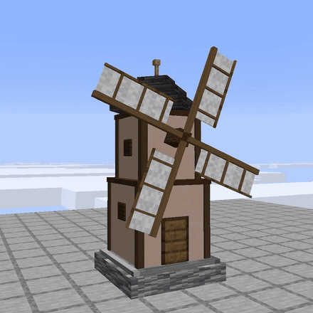
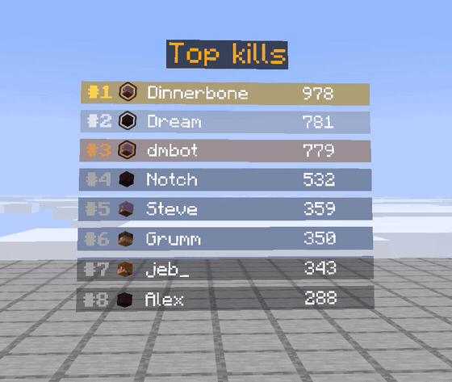

# displaymotion

[](https://jitpack.io/#Jan1k1/displaymotion)
[](https://papermc.io)
[](https://adoptium.net)
[](https://displaymotion.peakstone.app/docs/)

A **Java library** for Paper plugins that animates Minecraft **display entities**: item displays, block displays and text displays.
Your plugin calls it to build models, play animations, move them, let players click them and ride them.
No resource pack. No mods. No real entities. Packets only, through PacketEvents. No work on the main thread.

Java Edition only. Paper 1.21.4 to 26.3, Java 21 or newer. NPCs (mannequins) need a 1.21.9 or newer server.

<p align="center">
  
</p>

<p align="center">
  
  
</p>

## Setup

Two ways. Both have the same API.

**Plugin way (simplest).** The server owner installs `DisplayMotion.jar` from the [releases](https://github.com/Jan1k1/displaymotion/releases/latest) (PacketEvents is inside). You add this and write `depend: [DisplayMotion]` in `plugin.yml`:

```kotlin
repositories { maven("https://jitpack.io") }
dependencies { compileOnly("com.github.Jan1k1.displaymotion:displaymotion-paper:v0.4.0") }
```

**Shaded way.** You put the library in your own jar with `implementation(...)`. The server owner installs the PacketEvents plugin and you write `depend: [packetevents]`. No extra jar from us.

Details: [Getting started](docs/getting-started.md).

## Example

```java
DisplayMotion motion = DisplayMotion.create(plugin); // once, in onEnable

static final Animation SHOW = Animations.popIn(20)
        .then(Animations.spin(80).with(Animations.bob(0.3f, 80)));

MotionDisplay sword = motion.item(location, ItemStack.of(Material.DIAMOND_SWORD)).play(SHOW);

sword.play(Animations.popOut(10), sword::remove); // later: shrink, then remove
```

## What it does

**Models**
- Models from many blocks, items and texts, up to 256 parts. Parts have parents and move as one.
- Import models and animations from Blockbench (`.bbmodel`) and BDEngine (`.bdengine`).

**Animations**
- Presets (`popIn`, `spin`, `bob`, ...) or your own keyframes, combined with `then`, `with` and `loop`.
- Easing, also back, elastic and bounce. Crossfade from one animation to the next.
- Change the speed or the size at any time. Animation events run your code on a tick.

**Movement**
- `moveTo` and `moveAlong` (a smooth curve through points), with easing and an `onEnd`.
- `lookAt` a spot, or keep looking at a player or mob.
- `follow` an entity like a pet, or `ride` it. Hats and backpacks on players. Seats that players sit in.

**Text**
- Live text, a different text for each player, typing and counting text, a leaderboard that moves.
- Text style: background, line width, opacity, shadow, see through, alignment.

**Players**
- Clickable hitboxes with `onClick`.
- NPCs (mannequins) with skins, poses and items, that look at near players.
- Show a display to everyone or only to some players.

**Effects**
- Shatter, tombstone, sword rain, soul. One line each.

**Speed**
- One motion thread does the work. Packets are encoded once and shared. Parts that do not move are not sent.
- The client culls parts that are off screen. Invisible and tiny parts are not drawn at all. Far players get fewer parts (LOD).

## Docs

Also online: [displaymotion.peakstone.app/docs](https://displaymotion.peakstone.app/docs/).

- [Getting started](docs/getting-started.md): plugin way or shaded way, first display.
- [Animations](docs/animations.md)
- [Models](docs/models.md)
- [Effects](docs/effects.md)
- [Importing](docs/importing.md)
- [Cookbook](docs/cookbook.md)
- [How it works](docs/how-it-works.md)
- AI tools: [llms.txt](llms.txt)

## Try it

Build the example plugin and put it on a Paper 1.21.4 or newer server (with `DisplayMotion.jar` or the PacketEvents plugin):

```
./gradlew build
```

The jar is `example/build/libs/displaymotion-example-<version>.jar`. Commands: `/dm showcase` (everything at once), `/dm sword`, `/dm block`, `/dm windmill`, `/dm text`, `/dm pet`, `/dm path`, `/dm turret`, `/dm hat`, `/dm backpack`, `/dm selfview`, `/dm leaderboard`, `/dm ease`, `/dm npc`, `/dm bench`, `/dm button`, `/dm dragon [build|ice|ender|three]`, `/dm dragon ride [fire|ice|ender]`, `/dm effect <name>`, `/dm killeffect <name>`, `/dm model <file> [animation]`, `/dm debug`, `/dm stop`. Every command that spawns a display takes options after it, like `/dm sword size:3 speed:0.5 glow:gold` or `/dm text text:Hello there align:left`. Keys: `size`, `grow`, `speed`, `glow`, `bright`, `billboard`, `shadow`, `item`, `block`, `text` (last), `align`, `textshadow`, `seethrough`, `width`, `range`. Tab complete lists them.

## Modules

| Module | What | License |
| --- | --- | --- |
| `core` | Animations, poses, easing, matrix math. No Bukkit, no PacketEvents. Java 21. | MIT |
| `paper` | Sends the frames to players. | GPL-3.0-only |
| `example` | The test plugin. | GPL-3.0-only |

PacketEvents is GPL-3.0, so the module that uses it is GPL-3.0 too. `core` stays MIT, so you can write your own sender. This is not legal advice.

## Usage stats

`DisplayMotion.create(plugin)` sends anonymous stats to [bStats](https://bstats.org/plugin/bukkit/displaymotion/34708): how many servers use displaymotion and which plugins. It helps to see what people use. Turn it off with `DisplayMotion.create(plugin, false)`. Server owners can turn off all bStats in `plugins/bStats/config.yml`. The `Metrics` class is the official bStats single file class (MIT), only its package is changed.
